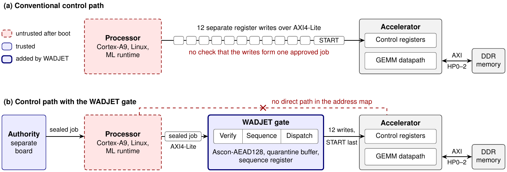
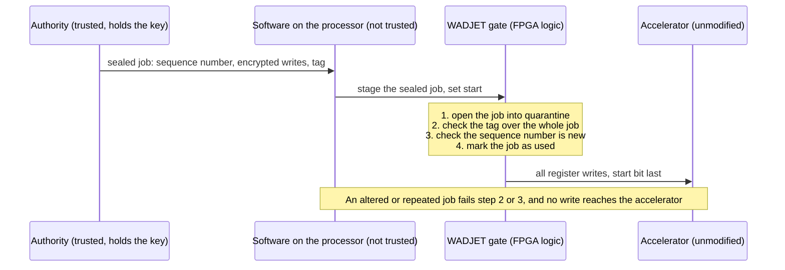
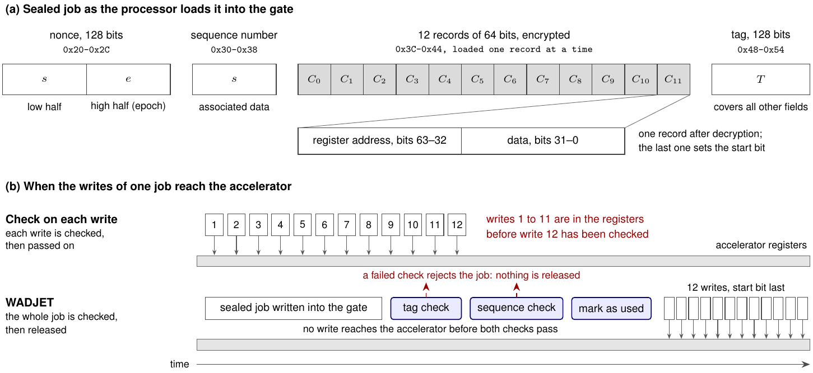
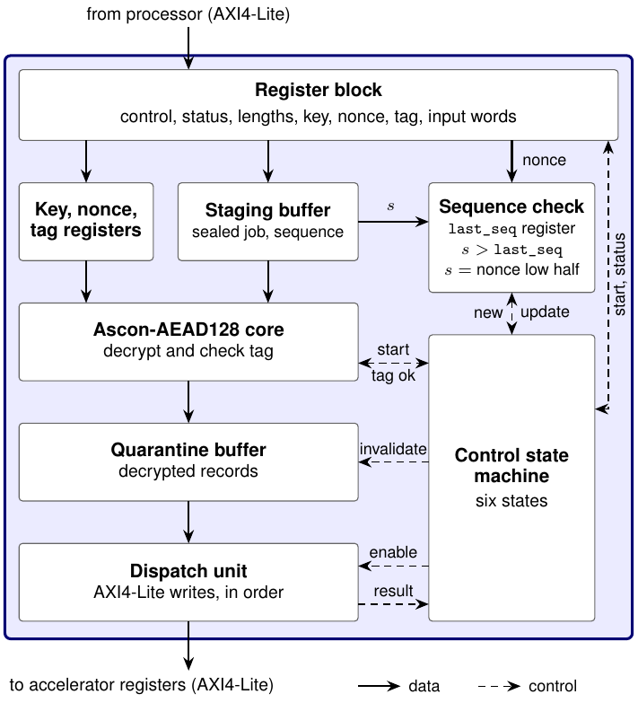
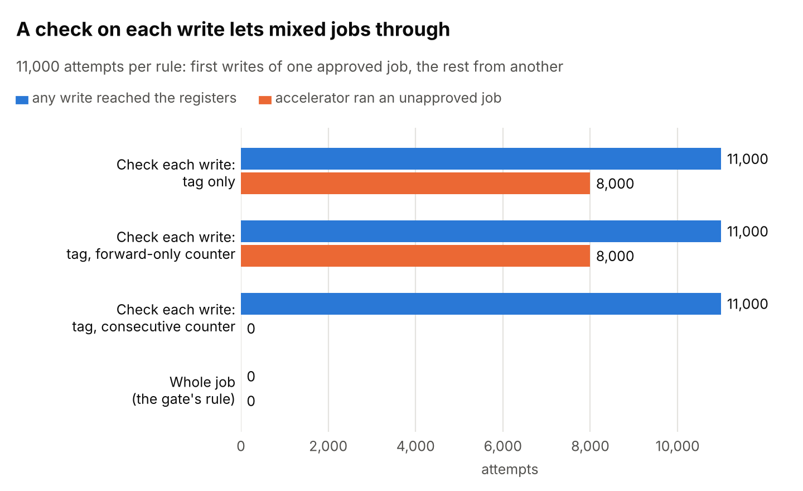
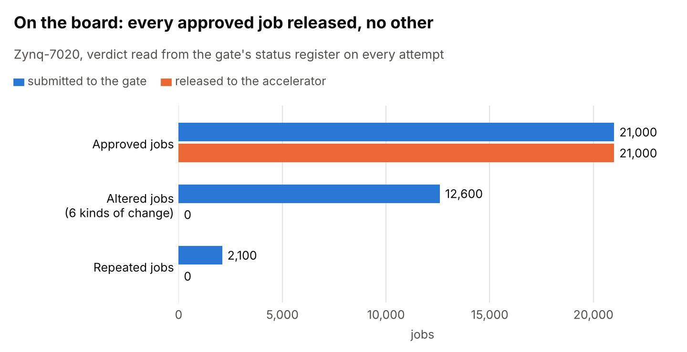
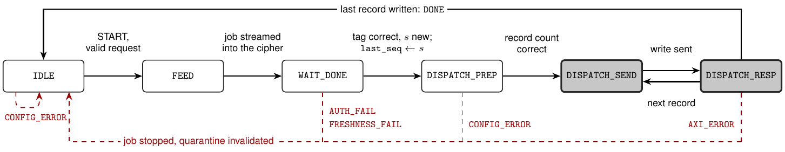
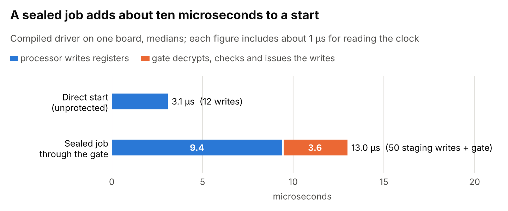
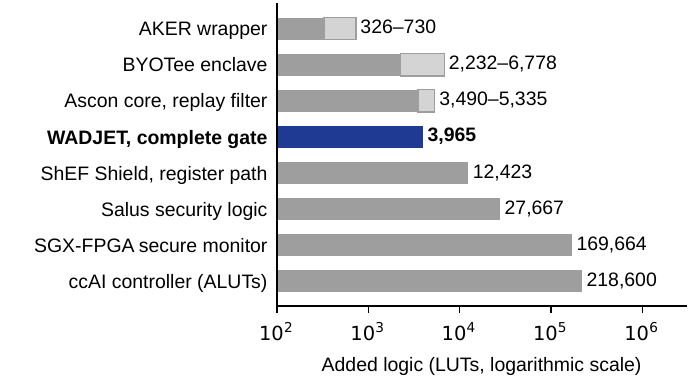

<p align="center">
  
</p>

<h1 align="center">WADJET</h1>

<p align="center">
  <b>Whole-Job Authorization and Dispatch for Job Execution Trust<br>on FPGA System-on-Chip Accelerators</b>
</p>

<p align="center">
  Prof. Mohamed El-Hadedy<br>
  Reconfigurable Space Computing Lab (RSCL), California State Polytechnic University, Pomona<br>
  Coordinated Science Laboratory, University of Illinois Urbana-Champaign
</p>

<p align="center">
  
  
  
  
  
</p>

<p align="center">
  <a href="#the-problem">Problem</a> ·
  <a href="#the-fix">Fix</a> ·
  <a href="#why-existing-protections-do-not-do-this">Related work</a> ·
  <a href="#evidence">Evidence</a> ·
  <a href="#run-the-mixing-experiment">Run it</a> ·
  <a href="docs/INTERFACE.md">Interface</a> ·
  <a href="docs/PROPERTIES.md">Proof</a> ·
  <a href="docs/RESULTS.md">Results</a> ·
  <a href="#how-to-cite">Cite</a>
</p>

---

## The problem

On an FPGA system-on-chip, the processor starts an accelerator by writing
its registers one by one and then setting a start bit. The hardware runs
whatever it finds in those registers. Faulty or compromised software can
therefore change one address or send an old job again, and the accelerator
still runs.

## The fix

WADJET is a gate in the FPGA logic that stands between the processor and
the accelerator's registers, and it is the processor's only way to them.

<p align="center">
  
</p>

A separate authority approves each job by encrypting and authenticating
the whole list of register writes, with a sequence number, using
Ascon-AEAD128 (NIST SP 800-232). The gate holds the job back until the
whole of it is verified, accepts only a sequence number newer than any it
has accepted, uses that number up, and then writes the registers of an
unmodified accelerator itself, with the start bit last.



This property is called **job-atomic release**: the decision to release is
taken once for the whole job, before any of its writes, and at most once.

Deciding whether one job was approved and is still unused takes three
things in one place:

| # | Condition | In the gate |
|---|---|---|
| 1 | The only way to the accelerator | The processor's bus reaches the gate and nothing else |
| 2 | The whole job held back until checked | Quarantine buffer, one tag over all the writes |
| 3 | A record of used approvals | Sequence register, updated before the first write |

The gate replaces only the processor's direct line to the registers. It
works beside existing protections, which keep deciding who may reach the
accelerator and keep its data safe.

### The sealed job

<p align="center">
  
</p>

```
key              128 bits   shared by the authority and the gate; software never holds it
nonce            128 bits   low half: sequence number     high half: epoch (session number)
associated data   64 bits   the sequence number again, covered by the tag
sealed records   8 bytes each   register address (bits 63..32), data (bits 31..0)
tag              128 bits   covers every record and the sequence number
```

The paper's accelerator takes 12 records per job. The gate accepts jobs
of 1 to 32 records. The full register map and the submission procedure
are in [`docs/INTERFACE.md`](docs/INTERFACE.md).

### Inside the gate

<p align="center">
  
</p>

## Why existing protections do not do this

| Guarantee | AKER | ShEF | Salus | ccAI | CAGE | StrongBox | Graviton | **WADJET** |
|---|:-:|:-:|:-:|:-:|:-:|:-:|:-:|:-:|
| Control writes or commands are authenticated | – | ✓ | ✓ | ✓ | ✓ | ○<sup>b</sup> | ✓ | **✓** |
| A whole job or task is verified before it starts | – | – | – | – | ✓ | ✓ | ✓ | **✓** |
| Repeated messages or jobs are rejected | – | ○<sup>c</sup> | ✓ | ✓ | ○<sup>d</sup> | ○<sup>e</sup> | ✓ | **✓** |
| The check runs in FPGA logic, with no CPU enclave, software monitor, or modified device | ✓ | ✓ | ○<sup>f</sup> | ○<sup>f</sup> | – | – | – | **✓**<sup>a</sup> |
| The accelerator's data is protected | ○<sup>g</sup> | ✓ | ○<sup>h</sup> | ✓ | ✓ | ✓ | ✓ | – |

<sub>✓ yes · ○ in part · – no.
<sup>a</sup> Trusted software loads the key at start-up and guards the reset and configuration of the logic; it checks no jobs.
<sup>b</sup> Checks the registers that the untrusted driver wrote but does not authenticate them.
<sup>c</sup> No counter is described for register messages.
<sup>d</sup> The signature covers the expected order of tasks; version numbers against rollback are proposed, not built.
<sup>e</sup> Detects a changed order of tasks; protection against a repeated task is not described.
<sup>f</sup> The check runs in FPGA logic but relies on an enclave or a confidential virtual machine on the host.
<sup>g</sup> Isolates memory regions without encrypting them.
<sup>h</sup> Data encryption is left to the accelerator's developer.
Entries are taken from the cited papers; the references are in the paper.</sub>

Two things exist separately in earlier work: a check of a whole task
before it starts, done by a software monitor or inside a modified device,
and a check in FPGA logic in front of an unmodified accelerator, done one
message at a time. WADJET does both at once. The gate invents no
cryptography; the contribution is architectural. It also does not protect
the accelerator's data, which the last row leaves to the protections it
works beside.

## Evidence

### 1. A check on each write lets mixed jobs through

A software model gives the same cipher, the same job format and the same
approved jobs to four release rules. The software that carries the
messages then delivers the first writes of one approved job followed by
the remaining writes of another. Every message it uses is authentic.

<p align="center">
  <picture>
    <source media="(prefers-color-scheme: dark)" srcset="docs/figures/chart_mixing_dark.png">
    
  </picture>
</p>

| Release rule | Attempts | Any write reached the registers | Accelerator ran an unapproved job |
|---|--:|--:|--:|
| Check each write: tag only | 11,000 | 11,000 | 8,000 |
| Check each write: tag and forward-only counter | 11,000 | 11,000 | 8,000 |
| Check each write: tag and consecutive counter | 11,000 | 11,000 | 0 |
| **Whole job (the gate's rule)** | 11,000 | **0** | **0** |

In the other 3,000 attempts of the first two rules, at the last three
split points, the mixture equals an approved job, because the control
writes are the same in every job. When a job is cut short after a full
job has run, all three per-write rules leave the registers holding a
mixture of two jobs, and the whole-job rule releases nothing.

The outcome under each rule is a property of the rule and not of where it
is built.

### 2. On the board, every approved job is released and no other

<p align="center">
  <picture>
    <source media="(prefers-color-scheme: dark)" srcset="docs/figures/chart_hardware_dark.png">
    
  </picture>
</p>

On a Zynq-7020 running a language model, the gate released all 21,000
approved jobs and none of 14,700 altered or repeated ones: seven kinds of
attack, 2,100 attempts each. The table by kind is in
[`docs/RESULTS.md`](docs/RESULTS.md).

### 3. The release path is proven for all inputs

The release path is proven on the Verilog source with the cipher core as
a black box and every bus input left free: 33 properties and 72 per-word
checks, by induction, in about 15 seconds. Twelve seeded faults were all
caught. The proof covers every job of 1 to 32 records. The nine
properties are listed in [`docs/PROPERTIES.md`](docs/PROPERTIES.md).

<p align="center">
  
</p>

### 4. The cost is small

<p align="center">
  <picture>
    <source media="(prefers-color-scheme: dark)" srcset="docs/figures/chart_cost_dark.png">
    
  </picture>
</p>

| | Gate | Share of the Zynq-7020 |
|---|--:|--:|
| Lookup tables | 3,965 | 7.45% |
| Flip-flops | 6,685 | 6.28% |
| Block RAM, DSP blocks | 0, 0 | 0% |
| Clock | 125 MHz | |

The gate needs a third of the lookup tables of ShEF's register
protection, which protects more. Both times in the chart start with the
job already in the processor's memory; the authority's sealing of a job
and its delivery to the processor are not included.

<p align="center">
  
</p>

## Run the mixing experiment

Python 3.10 or newer, nothing to install:

```
cd model
python mix_model.py
```

On Linux or macOS the command is `python3 mix_model.py`. The run takes
about 20 seconds and prints two tables:

```
job format: gemm12 (12 writes)   pairs of approved jobs: 1000   seed: 2026
control, untouched approved job runs as approved: R1 1000/1000, R2 1000/1000, R3 1000/1000, R4 1000/1000

MIX: first k writes of job X, rest from job Y
release rule                              attempts  writes reached  unapproved run
each write: tag only                         11000           11000            8000
each write: tag, forward-only counter        11000           11000            8000
each write: tag, consecutive counter         11000           11000               0
whole job (WADJET rule)                      11000               0               0

CUT SHORT: job X in full, then only the first k writes of job Y
release rule                              attempts  writes reached registers mixed
each write: tag only                         11000           11000            8000
each write: tag, forward-only counter        11000           11000            8000
each write: tag, consecutive counter         11000           11000            8000
whole job (WADJET rule)                      11000               0               0
```

Two other job formats give the same outcome:

```
python mix_model.py 200 2026 conv7
python mix_model.py 200 2026 max32
```

The whole-job rule in the model is a few lines
([`model/mix_model.py`](model/mix_model.py)):

```python
def submit(self, seq_nonce, seq_ad, body, tag):
    s = struct.pack(">Q", seq_ad)
    n = self.epoch + struct.pack(">Q", seq_nonce)
    if len(body) == 0 or len(body) % 8:
        return False
    quarantine = ascon.ascon_decrypt(self.key, n, s, body + tag, VAR)
    if quarantine is None:                      # tag check
        return False
    if seq_ad != seq_nonce or not seq_ad > self.last_seq:   # sequence check
        return False
    self.last_seq = seq_ad                      # used up before any write
    for i in range(0, len(quarantine), 8):
        self.acc.write(*unpack(quarantine[i:i + 8]))
    return True
```

The model compares release rules. It does not reproduce the
implementation of any published system, and its byte layout is its own
and is not the gate's wire format.

## What is in this repository

| Path | Content |
|---|---|
| [`model/mix_model.py`](model/mix_model.py) | The mixing experiment: four release rules, three job formats |
| [`model/ascon.py`](model/ascon.py) | Reference Python implementation of Ascon ([pyascon](https://github.com/meichlseder/pyascon)), unchanged, under its own licence |
| `model/RESULTS*.txt` | Outputs of the three runs reported above |
| [`docs/INTERFACE.md`](docs/INTERFACE.md) | The gate as software sees it: address map, sealed job, register map, outcomes, assumptions |
| [`docs/PROPERTIES.md`](docs/PROPERTIES.md) | The nine proven properties and how they were proven |
| [`docs/RESULTS.md`](docs/RESULTS.md) | Hardware results: attack table, resources, timing, cost |
| [`docs/make_charts.py`](docs/make_charts.py) | Draws the three charts on this page (needs matplotlib) |
| `docs/figures/` | Figures from the paper and the charts |
| `assets/` | Logos |

The hardware design files, the proof scripts and the software of the
authority and the boards are not part of this repository.

## What the gate assumes

The authority, the gate's own logic and FPGA configuration, the setup
step that loads and locks the key, and control of the reset, clock and
configuration of the programmable logic are trusted. Physical attacks,
side channels, fault injection, denial of service and the protection of
data in memory are outside the scope. Details are in
[`docs/INTERFACE.md`](docs/INTERFACE.md#what-the-gate-assumes).

## How to cite

```bibtex
@misc{elhadedy2026wadjet,
  author = {El-Hadedy, Mohamed},
  title  = {{WADJET}: Whole-Job Authorization and Dispatch for Job Execution
            Trust on {FPGA} System-on-Chip Accelerators},
  year   = {2026},
  note   = {Preprint},
  url    = {https://github.com/mealycpp/wadjet}
}
```

## Sponsors

<p align="center">
  
  
  
  
</p>

This work was supported by the U.S. Army Research Office (ARO) under Grant
W911NF-24-1-0265, the U.S. Navy Naval Engineering Education Consortium
(NEEC) under Grant N00174-23-1-0002, the Office of Naval Research (ONR)
Summer Faculty Research Program, and the Air Force Research Laboratory
(AFRL) under agreement FA8650-24-2-2403.

The U.S. Government is authorized to reproduce and distribute reprints for
Government purposes, notwithstanding any copyright notation thereon. The
views and conclusions are those of the author and do not necessarily
reflect the official policies or endorsements of ARO, ONR, AFRL, or the
U.S. Government.

## Rights and contact

© 2026 Mohamed El-Hadedy. All rights reserved. No licence is granted for
the contents of this repository, except `model/ascon.py`, which keeps the
licence of its source.

Prof. Mohamed El-Hadedy, mealy@cpp.edu, hadedy@illinois.edu
