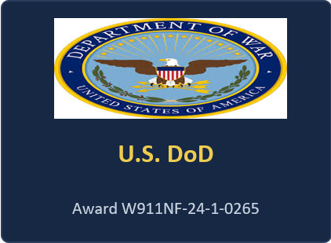
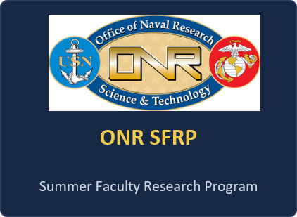

<p align="center">
  
</p>

# WADJET

**Whole-Job Authorization and Dispatch for Job Execution Trust on FPGA System-on-Chip Accelerators**

Prof. Mohamed El-Hadedy  
Reconfigurable Space Computing Lab (RSCL), California State Polytechnic University, Pomona  
Coordinated Science Laboratory, University of Illinois Urbana-Champaign

## The problem

On an FPGA system-on-chip, the processor starts an accelerator by writing
its registers one by one and then setting a start bit. The hardware runs
whatever it finds in those registers. Faulty or compromised software can
therefore change one address or send an old job again, and the accelerator
still runs.

## The fix

WADJET is a gate in the FPGA logic that stands between the processor and
the accelerator's registers, and it is the processor's only way to them.

- A separate authority approves each job by encrypting and authenticating
  the whole list of register writes, with a sequence number, using
  Ascon-AEAD128 (NIST SP 800-232).
- The gate holds the job back until the whole of it is verified, accepts
  only a sequence number newer than any it has accepted, uses that number
  up, and then writes the registers itself, with the start bit last.

This property is called **job-atomic release**: the decision to release is
taken once for the whole job, before any of its writes, and at most once.

The gate replaces only the processor's direct line to the registers. It
works beside existing protections, which keep deciding who may reach the
accelerator and keep its data safe.

## What is in this repository

| Folder | Content |
|---|---|
| `model/` | A software model that shows what reaches an accelerator's registers when approved jobs are mixed or cut short, under four release rules |
| `assets/` | Logos |

The hardware design files are not part of this repository.

## The mixing experiment

The model gives the same cipher, the same job format and the same approved
jobs to four release rules. The software that carries the messages then
delivers the first writes of one approved job followed by the remaining
writes of another. Every message it uses is authentic.

Run it (Python 3.10 or newer, nothing to install):

```
cd model
python mix_model.py
```

On Linux or macOS the command is `python3 mix_model.py`. The run takes
about 20 seconds and prints two tables. For the paper's 12-write job and
1,000 pairs of approved jobs:

| Release rule | Attempts | Any write reached the registers | Accelerator ran an unapproved job |
|---|---|---|---|
| Check each write: tag only | 11,000 | 11,000 | 8,000 |
| Check each write: tag and forward-only counter | 11,000 | 11,000 | 8,000 |
| Check each write: tag and consecutive counter | 11,000 | 11,000 | 0 |
| Whole job (the gate's rule) | 11,000 | 0 | 0 |

In the other 3,000 attempts of the first two rules, the mixture happened
to equal an approved job. A second table covers a job that is cut short
after a full job has run: all three per-write rules leave the registers
holding a mixture of two jobs, and the whole-job rule releases nothing.

Two other job formats give the same outcome:

```
python mix_model.py 200 2026 conv7
python mix_model.py 200 2026 max32
```

The outputs of these three runs are in `model/RESULTS.txt`,
`model/RESULTS_conv7.txt` and `model/RESULTS_max32.txt`.

The model compares release rules. It does not reproduce the implementation
of any published system.

`model/ascon.py` is the reference Python implementation of Ascon
([pyascon](https://github.com/meichlseder/pyascon)), unchanged.

## Sponsors

<p align="center">
  
  
  
  
</p>

This work was supported by the U.S. Army Research Office (ARO) under Grant
W911NF-24-1-0265, the U.S. Navy Naval Engineering Education Consortium
(NEEC) under Grant N00174-23-1-0002, the Office of Naval Research (ONR)
Summer Faculty Research Program, and the Air Force Research Laboratory
(AFRL) under agreement FA8650-24-2-2403.

The U.S. Government is authorized to reproduce and distribute reprints for
Government purposes, notwithstanding any copyright notation thereon. The
views and conclusions are those of the author and do not necessarily
reflect the official policies or endorsements of ARO, ONR, AFRL, or the
U.S. Government.

## Contact

Prof. Mohamed El-Hadedy, mealy@cpp.edu, hadedy@illinois.edu
