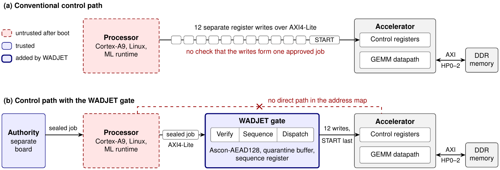
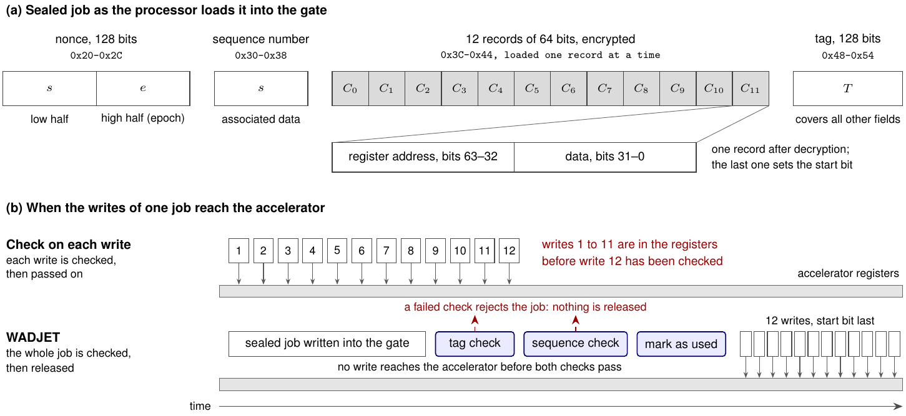

# The WADJET interface

This document describes the gate as software and an authority see it:
where it sits, the sealed job it accepts, its registers, and what it
reports. Everything here is taken from the paper. It is enough to build a
compatible authority or driver without the gate's hardware design files,
which are not part of this repository.

## Where the gate sits

The gate is a block in the FPGA logic of a Zynq-7000 system-on-chip. It
is the processor's only bus path to the accelerator's control registers.
The accelerator is used as generated by high-level synthesis and is not
modified.

Bus address map of the tested design:

| Master | Reaches | Base | Size |
|---|---|---|---|
| Processor (GP0) | Gate registers | `0x4000_0000` | 4 KB |
| Processor (GP0) | Accelerator registers | not mapped | n/a |
| Gate master | Accelerator registers | own space | 64 KB |
| Accelerator ACT port | Memory (HP0) | `0x0000_0000` | 128 MB |
| Accelerator WGT port | Memory (HP1) | `0x0800_0000` | 128 MB |
| Accelerator OUT port | Memory (HP2) | `0x1000_0000` | 128 MB |

The second general-purpose port of the processor (GP1) is disabled.
Bulk data does not pass through the gate: the accelerator keeps its own
ports to memory, and each port is limited to its own region.

## Who does what

| Party | Trusted | Role |
|---|---|---|
| Authority | yes | Holds the key and the sequence counter. Builds each job and seals it. |
| Software on the processor | no | Receives sealed jobs and writes them into the gate's registers. Cannot build a job the gate accepts. |
| Gate | yes | Verifies the whole job, checks that it is new, marks it as used, then writes the accelerator's registers itself. |
| Accelerator | unmodified | Runs what its registers hold when its start bit is written. |

## The sealed job

A job is the complete list of register writes that starts one run of the
accelerator. Each write is one 64-bit record: the register address in
bits 63 to 32 and the data in bits 31 to 0. The accelerator used in the
paper needs 12 writes, so its job is 96 bytes, and the start bit is
always the last record.

The authority seals a job with Ascon-AEAD128 (NIST SP 800-232):

| Field | Size | Content |
|---|---|---|
| Key | 128 bits | Shared by the authority and the gate. The software never holds it. |
| Nonce | 128 bits | Low half: the sequence number. High half: the epoch, a session number. |
| Associated data | 64 bits | The sequence number again. Not encrypted, but covered by the tag. |
| Sealed records | 8 bytes each | The encrypted records, 12 in the paper's job format. |
| Tag | 128 bits | Covers the records and the sequence number. |

If any register address, value or position in the job is changed, the
tag no longer matches. The same holds if the sequence number is changed.

In its default configuration the gate accepts jobs of 1 to 32 records.

## What the gate does with a job

1. If the key is not locked or the request is not well formed, the gate
   rejects it with `CONFIG_ERROR`.
2. The gate opens the job into a quarantine buffer. Nothing from the
   cipher reaches the accelerator directly.
3. If the tag does not match, the quarantine is invalidated and the job
   is rejected with `AUTH_FAIL`.
4. If the sequence number in the associated data differs from the one in
   the nonce, or is not higher than every number accepted since reset,
   the quarantine is invalidated and the job is rejected with
   `FRESHNESS_FAIL`.
5. The sequence register takes the job's number. The approval is now
   used up, before any write.
6. The gate writes each record's data to that record's register address,
   in order, one write at a time, waiting for each response. The start
   bit is last.
7. If a write returns a bus error, the gate stops, invalidates the
   quarantine and flags `AXI_ERROR`. Otherwise it flags `DONE`.

`DONE` means the gate has issued all the writes of the job. It does not
mean the accelerator has finished; the gate does not observe the
accelerator's own done signal.

## Register map (32-bit AXI4-Lite)

| Offset | Purpose |
|---|---|
| `0x00` | Control (write): bit 0 start; bit 1 clear staged-word counters; bit 2 clear status; bit 3 lock key (one-way) |
| `0x04` | Status (read): bit 0 active; 1 cipher busy; 2 done; 3 authentication OK; 4 authentication fail; 5 bus error; 6 configuration error; 7, 8 buffer overflow; 9 key locked; 10 dispatch busy; 11 freshness fail |
| `0x08` / `0x0C` | Lengths in bytes: sequence number (must be 8); sealed job (multiple of 8, at most 256) |
| `0x10` to `0x1C` | 128-bit key (write-only) |
| `0x20` to `0x2C` | 128-bit nonce: sequence number (low half), epoch (high half) |
| `0x30` to `0x38` | Sequence number: one 64-bit word in two halves, then a load strobe |
| `0x3C` to `0x44` | Sealed job: each 64-bit word in two halves, then a load strobe |
| `0x48` to `0x54` | 128-bit tag |
| `0x58` / `0x5C` | Word counts; version |

## Submitting a job

The processor clears the two staged-word counters, writes the two
lengths, the nonce, the sequence number, the sealed records and the tag,
and then sets the start bit. Every 64-bit word is written as two 32-bit
halves and is then appended to the staging buffer by a write to its load
register.

One 12-record job takes 51 register writes: 50 to stage it and one to set
the start bit. An unprotected start takes 12.

A request is well formed when the key is locked, the sequence number is
one 8-byte word, the job length is a nonzero multiple of 8 bytes that
fits the buffer, and the loaded word counts match both lengths.

While a job is being processed, the gate ignores writes to its key,
nonce, length, sequence, job and tag registers. It accepts only a request
to clear its status flags. The status flags are cleared at every start.

## Outcomes

| Flag | Meaning | Writes released |
|---|---|---|
| `DONE` | All records were written and acknowledged without error | all |
| `AUTH_FAIL` | The tag did not match | none |
| `FRESHNESS_FAIL` | The sequence number was not new | none |
| `CONFIG_ERROR` | Key not locked, or request not well formed | none |
| `AXI_ERROR` | The accelerator answered a write with a bus error | those before the failing write; the start bit is not written |

## Key, sequence number and sessions

- The key can be written until the lock bit is set. After that it cannot
  be changed until the gate is reset, and it reads back as zero.
- The gate rejects a start request unless the key is locked.
- The sequence register holds the highest number accepted since reset.
  Numbers must rise, but they need not be consecutive.
- A trusted restart resets the gate and loads a fresh key and a new,
  nonzero epoch. A job sealed in an earlier session then fails the tag
  check.
- The gate neither stores nor compares the epoch. It only keeps nonces
  different across sessions.

## What the gate assumes

Four elements are trusted:

1. The authority, a separate board that decides which jobs are allowed.
2. The gate's own logic and the FPGA configuration that contains it.
3. The setup step, in which trusted boot software loads a secret key into
   the gate and locks it before any untrusted software runs.
4. Control of the programmable logic: its reset, its clock and its
   configuration. A reset clears the gate's key, its key lock and its
   memory of past jobs, so untrusted software must not be able to reset
   or reconfigure the logic. This is a requirement on the platform and
   not something the gate enforces.

Physical attacks, side channels, fault injection and denial of service
are outside the scope, and so is the protection of data stored in memory.
Fixing the addresses in a job fixes where the accelerator reads and
writes; it does not stop the data stored there from being changed.
Software can still withhold a job.
