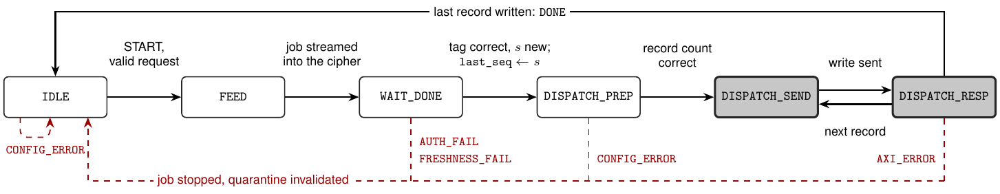

# What is proven about the gate

The release path of the gate was verified formally on its Verilog source.
The result holds for all input sequences, including ones that no test can
produce on demand, such as a write that arrives in the few microseconds
while the gate is busy, or a bus error from the accelerator.

## The properties

| # | Property |
|---|---|
| 1 | A write appears on the accelerator's bus only in the state that sends it, and the address and data on the bus are the quarantined record at the current index. |
| 2 | Dispatch is entered only after the cipher core reports a valid tag, with the sequence number equal to the nonce's low half and higher than every number accepted before. |
| 3 | The sequence register only moves forward, changes only at such a grant, and already holds the job's number in the cycle in which dispatch begins. |
| 4 | Each granted job has a sequence number above that of the job granted before it, so no job is granted twice. |
| 5 | While a job is in progress, and in the cycle in which the start request is taken, the key, nonce, lengths, tag, sequence word and sealed records cannot change. |
| 6 | The quarantined records cannot change between the grant and the end of dispatch; they are sent in order, one per acknowledged write, and their number equals the declared length. |
| 7 | A job that fails the tag or the sequence check returns the machine to `IDLE` with no write. A bus error from the accelerator ends the job at that write, after the earlier writes have been issued, and `DONE` is set only after the last record has been acknowledged without error. |
| 8 | A job is taken up only when the key is locked and the request is well formed; the lock is one-way, a locked key cannot change, and the key reads back as zero. |
| 9 | The gate never issues a read on the accelerator's bus. |

## How they were proven

- **Scope.** The cipher core was replaced by a black box whose outputs
  are unconstrained, and every bus input was left free. The result
  therefore holds for all input sequences and for any behavior of the
  core.
- **Size.** There are 33 properties, with a further 72 checks that cover
  each word of the buffers.
- **Method.** Proof by induction with the open-source SymbiYosys flow and
  the Z3 solver, in about 15 seconds.
- **Generality.** The proof leaves every register address, value and job
  length free. It holds for every job of 1 to 32 records, and not only
  for the 12-record job of the accelerator used in the paper.

## How the properties themselves were checked

- **Seeded faults.** Twelve faults were seeded into the Verilog one at a
  time. Among them: a release without a valid tag, a missing sequence
  comparison, a sequence register updated after dispatch, and a staged
  register that can change while a job is in progress. The proof failed
  for every one.
- **Reachability.** A bounded search from reset reached all six outcomes
  of the state machine, so the properties do not hold vacuously.

## What the proof does not cover

- It is on the Verilog source, with reset asserted once at the start, and
  not on the routed netlist.
- It shows that the gate never issues a write unless the core has
  reported a valid tag. That the core computes the cipher correctly rests
  on its agreement with the NIST test vectors and on the hardware
  experiments.

The proof scripts refer to the gate's internal signals and are not part
of this repository.
