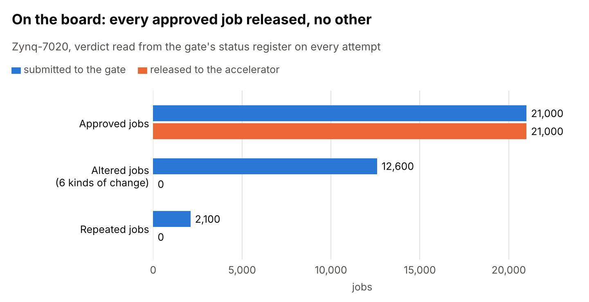
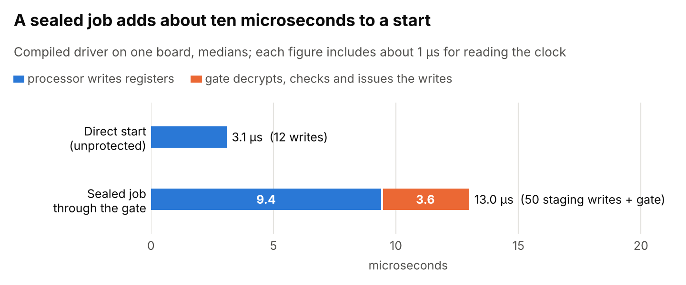
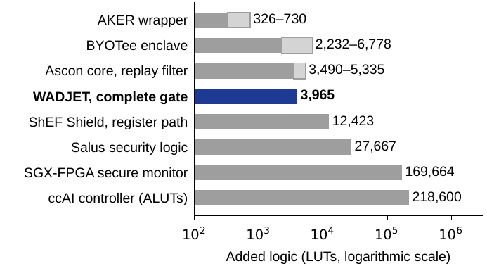
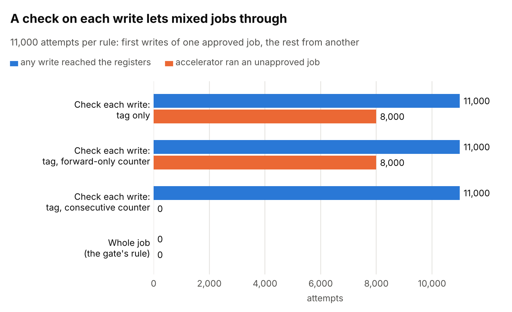

# Results

All numbers on this page are from the paper. The platform is a Zynq-7020
system-on-chip running a matrix-multiplication accelerator generated by
high-level synthesis, under a language-model workload.

## Approved jobs are released

<picture>
  <source media="(prefers-color-scheme: dark)" srcset="figures/chart_hardware_dark.png">
  
</picture>

The model was run 100 times, which sent 21,000 approved jobs through the
gate. All 21,000 were released.

## Altered and repeated jobs are not

Each kind of change was applied at each of the 210 job positions in the
model. The verdict on every attempt was read from the gate's hardware
status register.

| Attack | Attempts | Released | Stopped by |
|---|---|---|---|
| Changed tag | 2,100 | 0 | tag check |
| Changed input address | 2,100 | 0 | tag check |
| Changed weight address | 2,100 | 0 | tag check |
| Changed output address | 2,100 | 0 | tag check |
| Changed sizes | 2,100 | 0 | tag check |
| Changed control settings | 2,100 | 0 | tag check |
| Repeated job | 2,100 | 0 | sequence check |
| **All attacks** | **14,700** | **0** | |

One-sided 95% bound on the chance of a release per attempt, under an
independent-trial model: 2.4 × 10⁻⁴ for the 12,600 altered jobs and
1.4 × 10⁻³ for the 2,100 repeated jobs.

## Size and timing

| Quantity | Value |
|---|---|
| Gate lookup tables (share of device) | 3,965 (7.45%) |
| Gate flip-flops (share of device) | 6,685 (6.28%) |
| Gate block RAM, DSP blocks | 0, 0 |
| Accelerator lookup tables, flip-flops (share of device) | 10.0%, 7.8% |
| Accelerator block RAM, DSP blocks | 140 (100%), 132 (60%) |
| Clock | 125 MHz |
| Setup, hold slack | +0.048, +0.012 ns |
| Board power (whole board, external meter) | 5.1 W |

The gate needs no block RAM beside an accelerator that fills the
device's block RAM.

## What a sealed job costs

<picture>
  <source media="(prefers-color-scheme: dark)" srcset="figures/chart_cost_dark.png">
  
</picture>

Measured with a compiled driver on one board, as medians over 2,000
sealed jobs and 100,000 repetitions of the write sequences. Each figure
includes about 1 µs for reading the clock.

| Step | Time |
|---|---|
| Direct start, 12 register writes | 3.1 µs |
| Sealed job, 50 staging writes | 9.4 µs |
| Gate, start to done: median, maximum | 3.6, 4.3 µs |

A sealed job takes about 13 µs in all, against about 3 µs for a direct
start. Most of that time goes to staging the job; the gate itself needs
under 4 µs to decrypt it, check the tag and the sequence number, and
issue the writes. The cost is fixed: the gate handles the same number of
records for every job, whatever the size of the matrices, and data
transfers do not pass through it.

Both times start with the job already in the processor's memory. The
authority's sealing of a job and its delivery to the processor are not
included. The direct start was timed over the same bus port and not on a
build without the gate.

## Cost beside published protections

The designs in this figure were built on different devices and protect
different things, so the comparison is of order of magnitude. The paper
gives the full table and the caveats.

## What a check on each write lets through

<picture>
  <source media="(prefers-color-scheme: dark)" srcset="figures/chart_mixing_dark.png">
  
</picture>

See the mixing experiment in [`model/`](../model) and in the main
[README](../README.md). The charts on this page are drawn by
[`make_charts.py`](make_charts.py).
